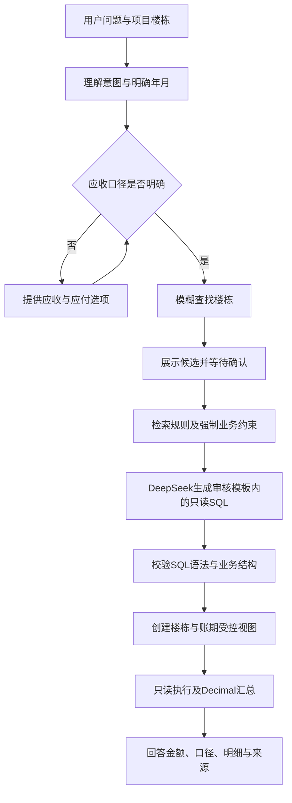

# 楼栋财务问数Agent设计

## 目标和边界

用户输入项目＋楼栋名及自然语言问题，得到SQLite实际取数结果、统计口径、账期和可追溯来源。默认查询全部已存日期；“应收”不明确时给出选择；楼栋支持错字和简称匹配，候选始终由用户确认。

数据入口固定配置为R33 / OBS-V18交付副本。正式数据库、Excel和结构入口继续保持R30 / OBS-V15。第一版不自动发现更高版本并切换；新版本需要先更新配置及验收绑定。

## 流程

LangGraph节点：`interpret → clarify → retrieve → generate_sql → validate_sql → execute → answer`。澄清节点可以提前结束本轮，用户点击选项后携带同一会话继续，原始问题与时间范围保留。模糊匹配只参与候选排序，不能直接决定合同或金额归属。

## 数据连接与是否需要更新SQLite

本轮对R33两份Excel主表与真实SQLite业务表做了全量值比较：T06-4为1487条，T05-3为391条，完全一致；R33交付文件、R31/R32来源和3份原始Excel指纹匹配，完整性与外键检查通过。因此R33数据已经在SQLite中，本轮无需重新入库，不生成重复版本。

详情由`scripts/verify_r33.py`生成到`runtime/r33_readonly_verification.json`。该脚本只读源库，并把核查结果写在Agent自己的运行目录，不改业务表、金额、计划、实付或三个正式指针。

每次查询检查数据库文件状态；文件变化会重新核对验收SHA-256。不匹配或存在活动WAL时停止查询，要求先验收一致快照，防止不知情地读取用户后来修改的内容。

## 第一版指标

| 问题口径 | 唯一取数主表 | 金额或结果 | 限制 |
|---|---|---|---|
| 楼栋合同 | T01 | 合同ID、类型、法律起止日期 | 不输出银行卡；声明函类型单列 |
| 我方应收 | T06-1 | company_fee_yuan | 登记基准，按review_status分组；不含调整 |
| 租客账单应收 | T05-1 | 费用金额（元） | 费用登记口径，尚不代表未收余额 |
| 收入登记 | T05 | amount_yuan | 不与T05-1、T05-2叠加 |
| 租客实收 | T05-2 | 金额（元） | 按实际费用归属月份 |
| 业主应付 | T06 | amount_yuan | 支出登记基准，不是最终净应付 |
| 业主成功实付 | T08-2 | 付款金额（元） | 状态为支付成功，按T01唯一楼栋映射；月份为来源单据月份 |
| 尾期水电 | T06-4 | 金额 | 可分别查水费、电费；正负号保留，冲突不强行采用 |
| 预留登记 | T06-5 | 金额（元） | 不等于余额或释放 |
| 调整登记 | T06-3 | adjustment_amount_yuan | 单独输出，不自动跨口径加减 |
| 支付计划 | T07 | 月份与计划状态、条数 | 不表示实际付款 |
| 退出记录 | T05-3 | 月份文本、退出形式、合同ID | 冲突字段为空并列来源 |

当前合同范围表沿用R30已采用分区，不将历史或其他楼栋留存表自动纳入；也不重新连接T01展示行求和。需要期外留存、任意联表、跨楼栋排行、最终余额或按实际付款日期分析时，应增加单独定义和验收的指标，不能让模型自行猜测。

## SQL与金额正确性

每种意图映射一个独立的`q_data`临时视图。它在只读连接内建立，服务器预先固定楼栋和账期，模型无权修改范围。金额按科目／月份或核对状态分组，使用注册的`DECIMAL_SUM`聚合器，避免TEXT金额被SQLite转成二进制浮点数。

第一版使用“审核SQL模板约束生成”：DeepSeek可以生成结构等价的SQL，SQLGlot解析后必须与该指标模板AST一致。此约束牺牲任意SQL自由度，以减少财务口径错误；网页明确列出支持的指标，不把该版本说成任意数据分析系统。

防护包括：单条SELECT、限定视图、AST业务结构比对、SQLite `mode=ro`、禁止扩展加载、SQLite授权回调、执行超时、完整结果分组数量上限。结果超限则要求缩小范围，不对截断的行计算总额。业务记录预览最多50条，汇总始终来自全部符合条件记录。

金额空白保持未知，明确0和负数保留；非法金额或超过分精度停止查询。无记录显示“未查到，不能认定0元”；部分金额未知时只报告已知金额合计并注明未知条数。

## 规则库及来源

`knowledge/rules.json`是人工可审阅的取数规则源文件；首次启动或规则指纹变化时，建立独立的`runtime/rules.sqlite`。每条规则包含ID、标题、规则正文、适用指标及依据。

向量检索只查规则库，金额只查业务SQLite，来源核对页不参与金额累计。尾期水电和退出另读取逐笔来源、逐行来源、问题清单和来源记录对照，把统一来源记录号展开为原工作表名称及实际行号。其他指标首先输出物理表及业务记录ID；未取得原Excel行号时不伪造完整来源链。

## 会话、API与网页

后端FastAPI，前端无远程CDN依赖的HTML/CSS/JS。`GET /api/status`显示数据版本、规则数量和模型状态；`POST /api/chat/stream`通过SSE接收问题并持续推送进度、答案分段及完整结果，`POST /api/chat`保留非流式兼容；请求包含项目、楼栋、会话ID和选项ID。没有直接执行任意SQL的HTTP入口。

会话仅保存在进程内，2小时过期，最多128个；重启会丢失会话。用户点击“新建查询”清空当前页面会话，项目楼栋输入保留。运行审计保存问题散列、指标、范围、SQL和数据库指纹，不保存API Key或完整财务明细。

API Key通过`config.local.json`中的`api_key_file`指定TXT路径；也支持`DEEPSEEK_API_KEY`环境变量。未配置时启用本地模板模式且页面标注，不能把它误报为已调用DeepSeek。真实API联调需要用户配置Key后进行。

## 后续阶段

第一阶段完成当前12类口径、候选确认、尾期来源追溯和真实库只读回归。第二阶段由负责人确定净应收、调整采用及核销定义，再增加受控指标。第三阶段增加中文语义Embedding、复杂问题分解和跨楼栋分析。网站化阶段增加用户认证、项目访问权限、私有部署及审计治理，不直接将本地SQLite或Key上传到网页。
